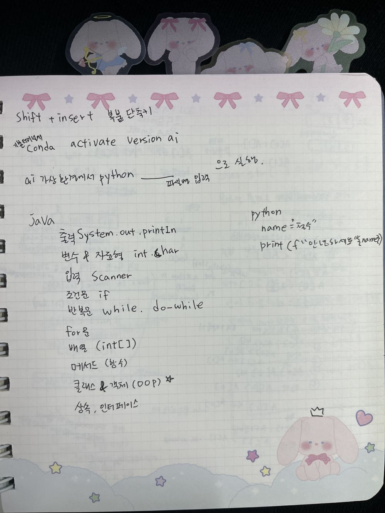
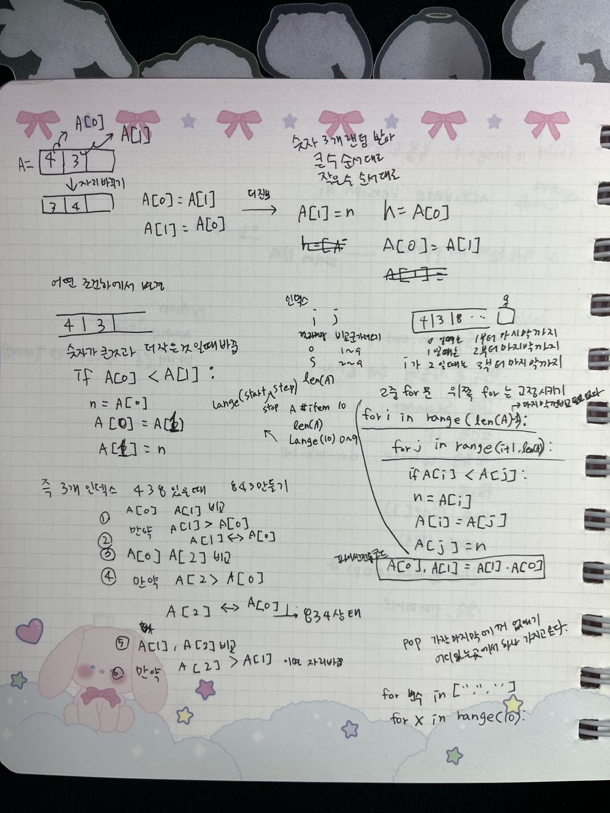
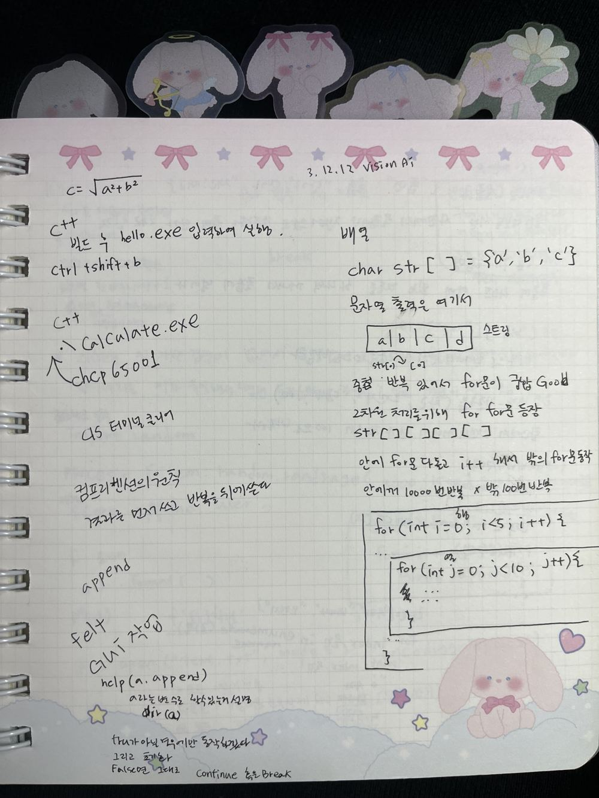
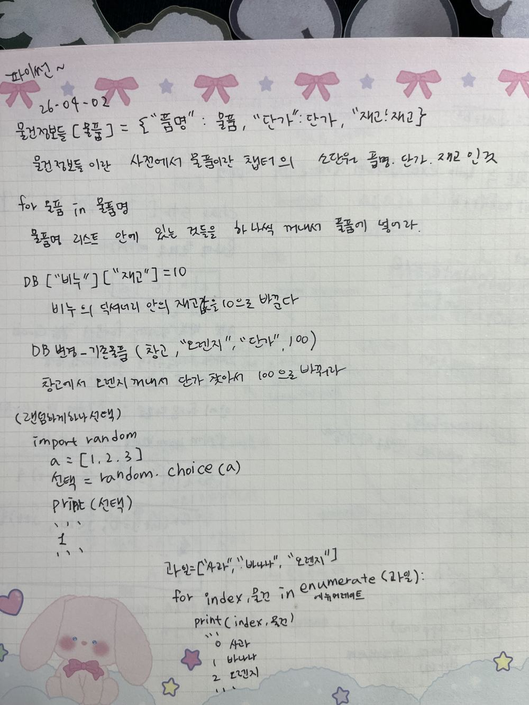
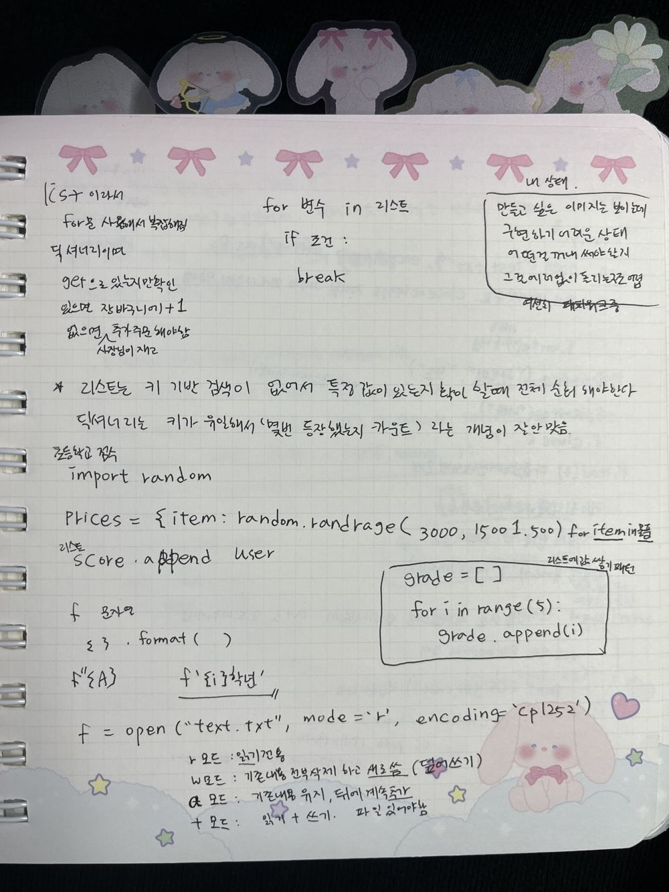
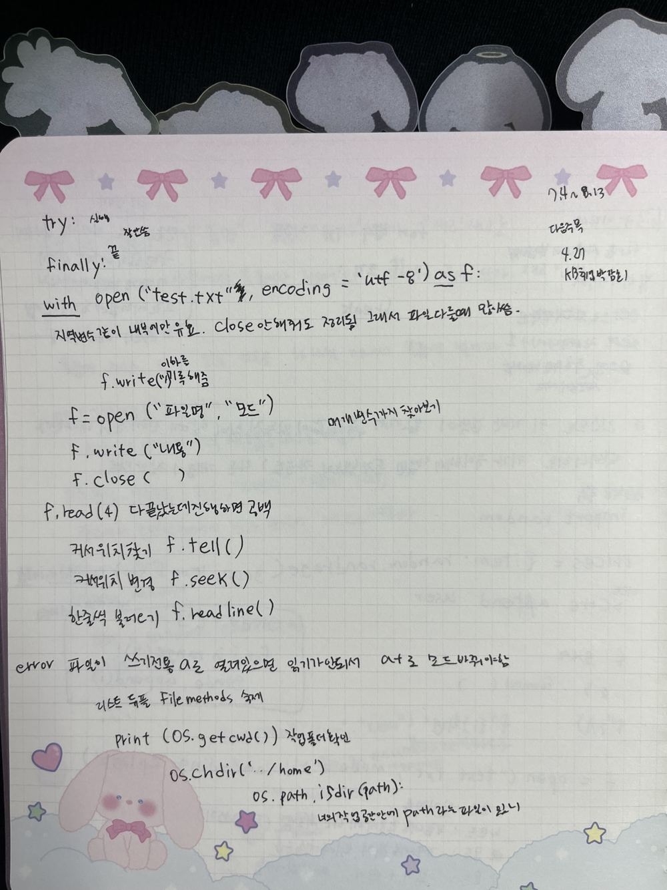
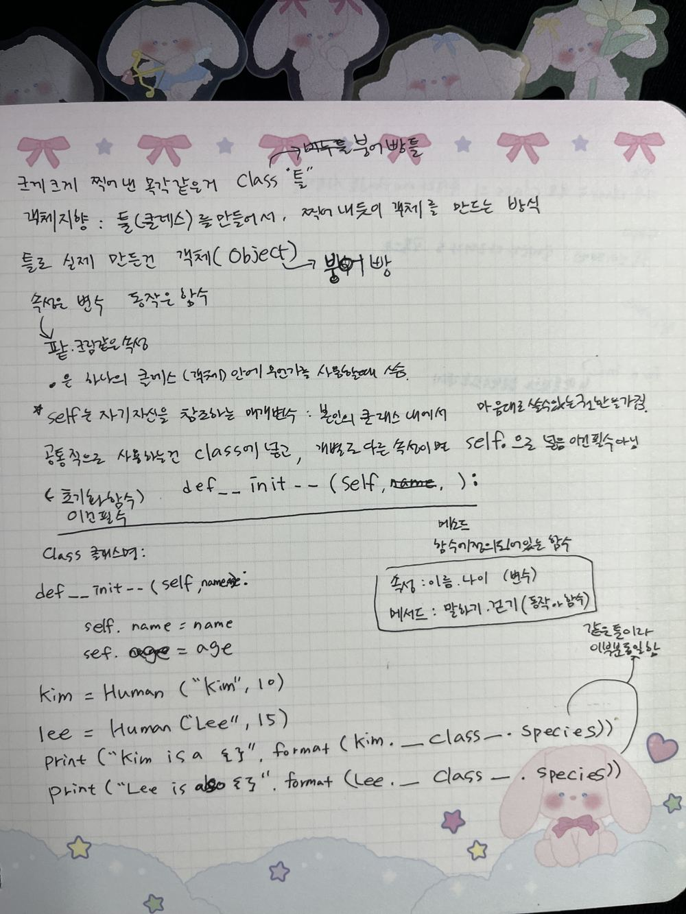
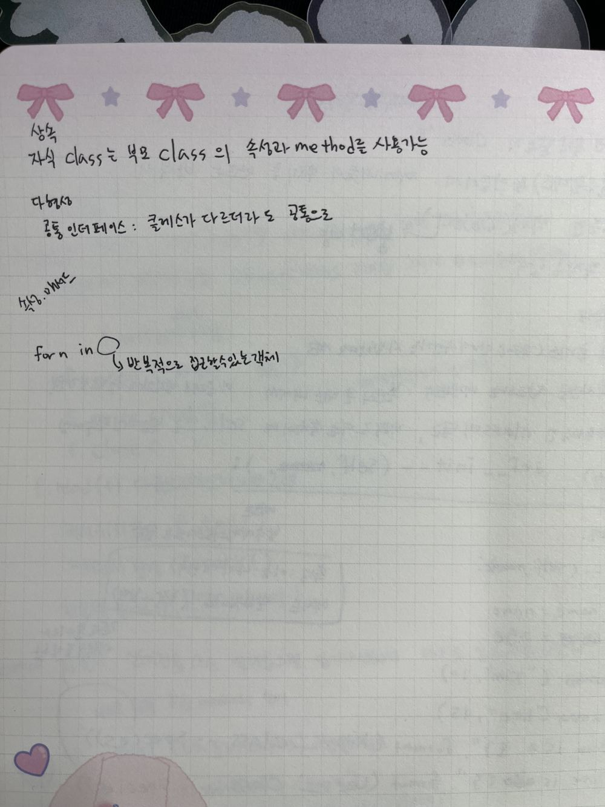
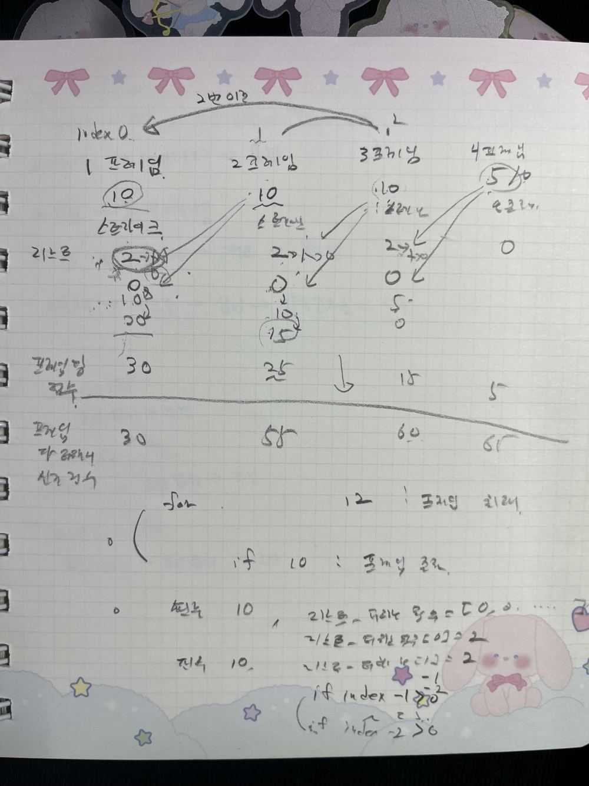
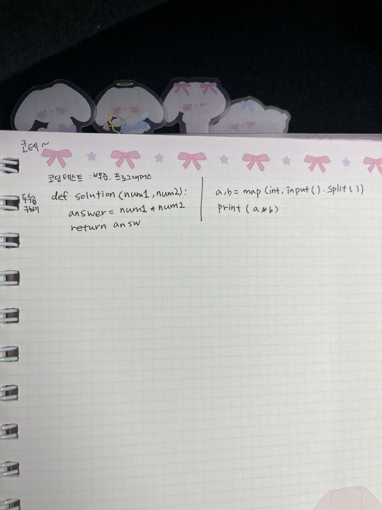

# 파이썬 수업 손필기 정리

> 한국폴리텍대학 AI소프트웨어과 하이테크과정 · 2026년 3월~ · Python 3.13.12 (수·목 수업)
> 수업 중에 노트에 적은 내용을 주제별로 다시 정리했습니다. 원본 필기 사진은 각 절 끝에 있습니다.

## 목차

1. [개발 환경](#개발-환경)
2. [값 교환과 이중 for문](#값-교환과-이중-for문)
3. [반복문 · 컴프리헨션 · 도움말](#반복문--컴프리헨션--도움말)
4. [딕셔너리와 enumerate](#딕셔너리와-enumerate)
5. [리스트 vs 딕셔너리, 문자열 포매팅, 파일 모드](#리스트-vs-딕셔너리-문자열-포매팅-파일-모드)
6. [with문, 파일 메서드, os 모듈](#with문-파일-메서드-os-모듈)
7. [클래스와 객체](#클래스와-객체)
8. [상속 · 다형성 · 이터러블](#상속--다형성--이터러블)
9. [볼링 점수 계산 설계](#볼링-점수-계산-설계)
10. [코딩 테스트 입문](#코딩-테스트-입문)

---

## 개발 환경

- 기본 터미널에서 `conda activate ai` → ai 가상환경에서 `python 파일명`으로 실행
- 터미널 붙여넣기 단축키: `Shift + Insert`
- f-string 첫 사용: `name = "찬수"` → `print(f"안녕하세요 {name}")`

관련 코드: [`01_basics/`](../01_basics)

<details><summary>필기 원본</summary>


</details>

## 값 교환과 이중 for문

숫자 3개를 랜덤으로 받아 큰 수 순서대로 정렬하는 문제에서 시작했다.

```python
# A[0] = A[1] 을 바로 하면 원래 A[0] 값이 사라진다 → 임시 변수 사용
n = A[0]
A[0] = A[1]
A[1] = n

# 파이썬식 교환
A[0], A[1] = A[1], A[0]
```

- 4, 3, 8을 8, 4, 3으로 만들려면: A[0]과 A[1] 비교 → 교환, A[0]과 A[2] 비교 → 교환, A[1]과 A[2] 비교 → 교환
- 이걸 일반화한 것이 **이중 for문**이다. 바깥 `for`는 기준 위치를 고정하고, 안쪽 `for`는 그 다음 칸부터 끝까지 비교한다.

```python
for i in range(len(A) - 1):          # 마지막 칸은 비교할 필요 없음
    for j in range(i + 1, len(A)):
        if A[i] < A[j]:
            A[i], A[j] = A[j], A[i]
```

- `range(start, stop, step)`: `range(10)`은 0~9
- `pop()`: 마지막 값을 꺼내면서 없앤다. 인덱스를 주면 그 위치의 값을 꺼낸다.

관련 코드: [`05_algorithms/0430_selection_sort.py`](../05_algorithms/0430_selection_sort.py)

<details><summary>필기 원본</summary>


</details>

## 반복문 · 컴프리헨션 · 도움말

- **컴프리헨션 원칙**: 결과를 먼저 쓰고, 반복은 뒤에 쓴다.
- `help(a.append)`: 메서드 설명 보기 / `dir(a)`: `a`로 쓸 수 있는 메서드 목록 보기
- `while`은 조건이 `True`인 동안 계속 돈다. `continue`는 이번 회차만 건너뛰고, `break`는 반복을 끝낸다.
- Flet으로 GUI 작업 시작

<details><summary>필기 원본</summary>


</details>

## 딕셔너리와 enumerate

> 26-04-02 · 장바구니 계산 / 재고·매출 관리 과제

```python
물건정보들[물품] = {"품명": 물품, "단가": 단가, "재고": 재고}  # 중첩 딕셔너리
DB["비누"]["재고"] = 10        # 비누 딕셔너리 안의 재고 값을 10으로 변경
DB변경_기존물품(창고, "오렌지", "단가", 100)   # 함수로 같은 작업

import random
선택 = random.choice([1, 2, 3])   # 리스트에서 하나 랜덤 선택

for index, 물건 in enumerate(["사과", "바나나", "오렌지"]):
    print(index, 물건)   # 0 사과 / 1 바나나 / 2 오렌지
```

관련 코드: [`02_projects/market/`](../02_projects/market)

<details><summary>필기 원본</summary>


</details>

## 리스트 vs 딕셔너리, 문자열 포매팅, 파일 모드

- 처음에 장바구니를 리스트로 만들었더니 `for`문을 돌려야 해서 코드가 복잡해졌다.
  딕셔너리로 바꾸면 `get()`으로 있는지 바로 확인해서, 있으면 장바구니 `+1`, 없으면 새로 추가하면 된다.
- ★ **리스트는 키로 찾는 기능이 없어서 특정 값이 있는지 보려면 전체를 순회해야 한다. 딕셔너리는 키가 유일해서 "몇 번 나왔는지 세기"에 잘 맞는다.**
- 딕셔너리 컴프리헨션: `prices = {item: random.randrange(3000, 15001, 500) for item in 물품}`
- 리스트에 값 쌓기 패턴: `grade = []` → `for i in range(5): grade.append(i)`
- 문자열 포매팅: `"{}".format(값)`, `f"{A}"`, `f'{i}학년'`

| 파일 모드 | 의미 |
|---|---|
| `r` | 읽기 전용 |
| `w` | 기존 내용을 지우고 새로 씀 (덮어쓰기) |
| `a` | 기존 내용 유지, 뒤에 추가 |
| `+` | 읽기 + 쓰기 (파일이 있어야 함) |

> 📝 당시 메모: "만들고 싶은 모습은 보이는데 구현하기가 어렵다. 어떤 걸 꺼내 써야 할지 모르겠고, 그 부분의 이론이 부족하다."
> → 이후 자료구조 수업에서 리스트·스택·큐·덱을 직접 구현해 보았다. ([`04_data_structures/`](../04_data_structures))

<details><summary>필기 원본</summary>


</details>

## with문, 파일 메서드, os 모듈

```python
try:
    ...            # 실행
finally:
    ...            # 끝나면 항상 실행

with open("test.txt", encoding="utf-8") as f:   # 블록 안에서만 유효, close() 자동
    ...

f = open("파일명", "모드")
f.write("내용")
f.close()
```

- `f.read(4)`: 4글자 읽기. 다 읽은 뒤 더 읽으면 빈 문자열
- `f.tell()`: 커서 위치 / `f.seek()`: 커서 위치 변경 / `f.readline()`: 한 줄씩
- 오류 경험: 파일을 `a`(쓰기 전용)로 열면 읽기가 안 된다 → `a+`로 바꿔야 함
- `os.getcwd()`: 작업 폴더 확인 / `os.chdir('../home')` / `os.path.isdir(path)`: 그 경로가 폴더인지 확인

관련 코드: [`04_data_structures/03_line_editor_flet.py`](../04_data_structures/03_line_editor_flet.py) (파일 저장·불러오기), [`03_oop/phonebook/04_phonebook_flet_json.py`](../03_oop/phonebook/04_phonebook_flet_json.py)

<details><summary>필기 원본</summary>


</details>

## 클래스와 객체

- **클래스는 붕어빵 틀**이고, 틀로 찍어낸 붕어빵이 **객체(Object)**다.
- 객체지향: 틀(클래스)을 만들어 두고 찍어내듯 객체를 만드는 방식
- 속성은 변수(팥, 크림), 동작은 함수(메서드)다.
- `.`은 클래스(객체) 안의 무언가를 쓸 때 사용한다.
- `self`는 자기 자신을 가리키는 매개변수다.
- 모든 객체가 같이 쓰는 값은 클래스에 두고, 객체마다 다른 값은 `self.`으로 넣는다.
- `__init__`은 객체를 만들 때 실행되는 초기화 함수다.

```python
class Human:
    species = "Homo sapiens"          # 공통 속성 (필기에는 생략, 예시 값)

    def __init__(self, name, age):    # 초기화 함수
        self.name = name              # 객체마다 다른 속성
        self.age = age

kim = Human("Kim", 10)
lee = Human("Lee", 15)
print("Kim is a {}".format(kim.__class__.species))
print("Lee is also {}".format(lee.__class__.species))   # 같은 틀이라 값이 같다
```

관련 코드: [`03_oop/`](../03_oop)

<details><summary>필기 원본</summary>


</details>

## 상속 · 다형성 · 이터러블

- **상속**: 자식 클래스는 부모 클래스의 속성과 메서드를 쓸 수 있다.
- **다형성**: 클래스가 달라도 같은 이름의 메서드로 다룰 수 있는 공통 인터페이스
- `for n in ○`: ○ 자리에는 하나씩 꺼낼 수 있는 객체(이터러블)가 온다.

<details><summary>필기 원본</summary>


</details>

## 볼링 점수 계산 설계

코드를 짜기 전에 프레임별로 보너스가 어디로 더해지는지 화살표로 그려 봤다.

- 스트라이크(10) → 다음 **2구**를 더함 / 스페어 → 다음 **1구**를 더함
- 지금 투구가 `index`라면 `index-1`, `index-2` 프레임에 보너스가 남았는지 확인해서 더한다.
- 프레임별 점수와 누적 점수를 따로 저장한다.

관련 코드: [`02_projects/bowling/`](../02_projects/bowling)

<details><summary>필기 원본</summary>


</details>

## 코딩 테스트 입문

백준·프로그래머스 문제 풀이 형식 익히기 (두 수의 곱)

```python
# 프로그래머스: 함수를 완성하는 형식
def solution(num1, num2):
    answer = num1 * num2
    return answer

# 백준: 입력을 직접 받는 형식
a, b = map(int, input().split())
print(a * b)
```

<details><summary>필기 원본</summary>


</details>
